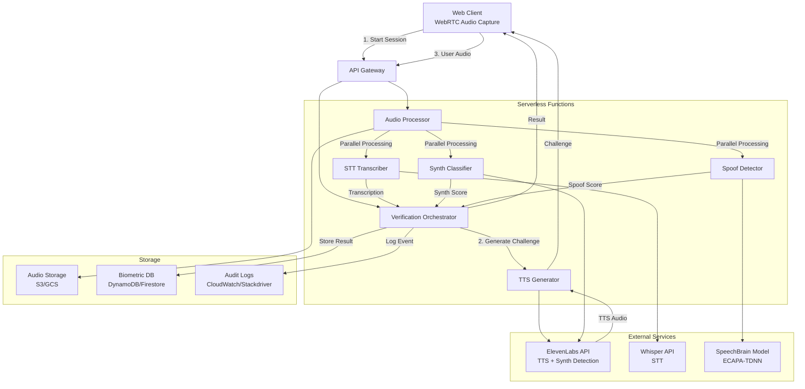

# VoiceLiveness Onboarder - Design Document

## Overview

VoiceLiveness Onboarder (VLO) is a serverless voice biometrics system that verifies live human users during account onboarding. The system combines WebRTC for real-time audio capture, ElevenLabs for TTS challenge generation and synthetic voice detection, OpenAI Whisper for speech-to-text transcription, and SpeechBrain ECAPA-TDNN for anti-spoofing. The entire verification flow completes in under 10 seconds.

### Key Design Principles

- **Serverless-first**: All backend logic runs in serverless functions (AWS Lambda, Google Cloud Functions, or similar)
- **WebRTC-native**: Browser-based audio capture without plugins or native apps
- **Defense in depth**: Multiple independent checks (STT matching, synth detection, spoof detection)
- **Performance-optimized**: Parallel processing and optimized model inference to meet <10s target
- **Audit-ready**: Comprehensive logging for compliance and security investigations

## Architecture

### High-Level Architecture



### Component Architecture

The system follows a microservices pattern with serverless functions:

1. **Client Layer**: Browser-based WebRTC audio capture and UI
2. **API Layer**: REST/WebSocket API for session management
3. **Orchestration Layer**: Coordinates verification workflow
4. **Processing Layer**: Parallel audio analysis services
5. **Storage Layer**: Audio artifacts, biometric data, and audit logs

### Data Flow

1. **Session Initiation**: Client requests verification session, receives session ID and TTS challenge
2. **Challenge Playback**: Client plays TTS audio and displays text prompt
3. **Audio Capture**: Client captures user voice via WebRTC, sends to backend
4. **Parallel Analysis**: Audio is simultaneously processed by STT, synth classifier, and spoof detector
5. **Result Aggregation**: Orchestrator combines results and computes liveness score
6. **Response**: Client receives pass/fail result with feedback

## Components and Interfaces

### 1. Web Client Component

**Responsibilities:**
- WebRTC audio capture and streaming
- UI for challenge display and user feedback
- Session state management

**Key Interfaces:**

```typescript
interface VLOClient {
  // Initialize verification session
  startSession(): Promise<SessionResponse>;
  
  // Play TTS challenge to user
  playChallengeAudio(audioUrl: string): Promise<void>;
  
  // Capture user audio via WebRTC
  captureAudio(durationMs: number): Promise<AudioBlob>;
  
  // Submit audio for verification
  submitAudio(sessionId: string, audio: AudioBlob): Promise<VerificationResult>;
  
  // Get real-time audio level for UI feedback
  getAudioLevel(): number;
}

interface SessionResponse {
  sessionId: string;
  challengeText: string;
  challengeAudioUrl: string;
  expiresAt: number;
}

interface VerificationResult {
  success: boolean;
  livenessScore: number;
  reason?: 'synthetic_voice' | 'spoof_detected' | 'phrase_mismatch' | 'poor_audio';
  details: {
    sttMatch: number;
    synthProbability: number;
    spoofScore: number;
  };
}
```

**Technology Stack:**
- WebRTC getUserMedia API for audio capture
- Web Audio API for audio level visualization
- TypeScript/React for UI

### 2. API Gateway Component

**Responsibilities:**
- Request routing and authentication
- Rate limiting and DDoS protection
- CORS and security headers

**Endpoints:**

```
POST   /api/v1/sessions          - Create verification session
GET    /api/v1/sessions/:id      - Get session status
POST   /api/v1/sessions/:id/audio - Submit audio for verification
GET    /api/v1/sessions/:id/result - Get verification result
```

**Technology Stack:**
- AWS API Gateway / Google Cloud API Gateway
- JWT for session tokens
- CloudFront/CDN for TTS audio delivery

### 3. Verification Orchestrator

**Responsibilities:**
- Coordinate verification workflow
- Aggregate results from parallel processors
- Compute final liveness score
- Manage session state

**Key Logic:**

```typescript
interface VerificationOrchestrator {
  // Create new verification session
  createSession(userId: string): Promise<Session>;
  
  // Process submitted audio through all checks
  processAudio(sessionId: string, audioData: Buffer): Promise<VerificationResult>;
  
  // Aggregate results from parallel processors
  aggregateResults(
    sttResult: STTResult,
    synthResult: SynthResult,
    spoofResult: SpoofResult
  ): VerificationResult;
}

interface Session {
  id: string;
  userId: string;
  challengePhrase: string;
  challengeAudioUrl: string;
  createdAt: number;
  expiresAt: number;
  status: 'pending' | 'processing' | 'completed' | 'failed';
}
```

**Decision Logic:**
- All three checks (STT, synth, spoof) must pass for verification success
- STT match threshold: 85%
- Synth probability threshold: 0.05
- Spoof EER threshold: 1%

### 4. TTS Generator Service

**Responsibilities:**
- Generate random challenge phrases
- Call ElevenLabs TTS API
- Store and serve TTS audio

**Implementation:**

```typescript
interface TTSGenerator {
  // Generate challenge phrase and TTS audio
  generateChallenge(): Promise<Challenge>;
}

interface Challenge {
  text: string;
  audioUrl: string;
  audioData: Buffer;
}
```

**Challenge Phrase Strategy:**
- Random selection from phrase bank (100+ phrases)
- 5-8 words per phrase
- Phonetically diverse for better biometric capture
- Examples: "The quick brown fox jumps over the lazy dog", "My voice is my password"

### 5. Audio Processor Service

**Responsibilities:**
- Receive and validate audio data
- Store audio artifacts
- Trigger parallel analysis services
- Format audio for different models

**Implementation:**

```typescript
interface AudioProcessor {
  // Process incoming audio
  processAudio(sessionId: string, audioData: Buffer): Promise<ProcessedAudio>;
  
  // Store audio artifact
  storeAudio(sessionId: string, audioData: Buffer): Promise<string>;
  
  // Validate audio quality
  validateAudio(audioData: Buffer): AudioValidation;
}

interface ProcessedAudio {
  sessionId: string;
  audioUrl: string;
  duration: number;
  sampleRate: number;
  format: string;
}

interface AudioValidation {
  valid: boolean;
  duration: number;
  sampleRate: number;
  hasClipping: boolean;
  snr: number; // Signal-to-noise ratio
}
```

**Audio Requirements:**
- Format: WAV or WebM
- Sample rate: 16kHz minimum
- Duration: 2-10 seconds
- Bit depth: 16-bit minimum

### 6. STT Transcriber Service

**Responsibilities:**
- Transcribe audio using Whisper API
- Compare transcription to challenge phrase
- Calculate similarity score

**Implementation:**

```typescript
interface STTTranscriber {
  // Transcribe audio to text
  transcribe(audioData: Buffer): Promise<STTResult>;
  
  // Calculate similarity between transcription and challenge
  calculateSimilarity(transcription: string, challenge: string): number;
}

interface STTResult {
  transcription: string;
  confidence: number;
  similarity: number;
  matched: boolean;
}
```

**Similarity Algorithm:**
- Levenshtein distance for character-level comparison
- Normalize for case and punctuation
- Account for common transcription errors
- Threshold: 85% similarity required

### 7. Synth Classifier Service

**Responsibilities:**
- Detect synthetic/AI-generated voices
- Call ElevenLabs classification API
- Return probability score

**Implementation:**

```typescript
interface SynthClassifier {
  // Classify audio as human or synthetic
  classify(audioData: Buffer): Promise<SynthResult>;
}

interface SynthResult {
  probability: number; // 0-1, higher = more likely synthetic
  isSynthetic: boolean; // true if probability > 0.05
  modelVersion: string;
}
```

**Detection Strategy:**
- ElevenLabs provides trained classifier for detecting AI voices
- Threshold: 0.05 probability (95% confidence of human voice required)
- Log all scores for continuous model improvement

### 8. Spoof Detector Service

**Responsibilities:**
- Detect replay attacks and spoofed audio
- Run SpeechBrain ECAPA-TDNN model
- Calculate anti-spoofing score

**Implementation:**

```typescript
interface SpoofDetector {
  // Detect spoofed or replayed audio
  detect(audioData: Buffer): Promise<SpoofResult>;
}

interface SpoofResult {
  score: number; // Anti-spoofing score
  eer: number; // Equal Error Rate
  isSpoofed: boolean; // true if EER > 1%
  modelVersion: string;
}
```

**Model Details:**
- SpeechBrain ECAPA-TDNN pre-trained model
- Detects: replay attacks, voice conversion, TTS spoofing
- Target EER: <1%
- Model hosting: Serverless inference (AWS Lambda with container image or SageMaker Serverless)

## Data Models

### Session Model

```typescript
interface Session {
  id: string;                    // UUID
  userId: string;                // User identifier
  challengePhrase: string;       // Text user must speak
  challengeAudioUrl: string;     // TTS audio URL
  status: SessionStatus;
  createdAt: number;             // Unix timestamp
  expiresAt: number;             // Unix timestamp (5 min expiry)
  audioUrl?: string;             // User audio URL
  result?: VerificationResult;
  metadata: {
    ipAddress: string;
    userAgent: string;
    consentTimestamp: number;
  };
}

enum SessionStatus {
  PENDING = 'pending',
  PROCESSING = 'processing',
  COMPLETED = 'completed',
  FAILED = 'failed',
  EXPIRED = 'expired'
}
```

### Verification Result Model

```typescript
interface VerificationResult {
  sessionId: string;
  success: boolean;
  livenessScore: number;         // 0-100 composite score
  timestamp: number;
  checks: {
    stt: STTResult;
    synth: SynthResult;
    spoof: SpoofResult;
  };
  reason?: FailureReason;
  processingTimeMs: number;
}

enum FailureReason {
  SYNTHETIC_VOICE = 'synthetic_voice',
  SPOOF_DETECTED = 'spoof_detected',
  PHRASE_MISMATCH = 'phrase_mismatch',
  POOR_AUDIO = 'poor_audio',
  TIMEOUT = 'timeout'
}
```

### Audit Log Model

```typescript
interface AuditLog {
  id: string;
  sessionId: string;
  userId: string;
  timestamp: number;
  event: AuditEvent;
  result: VerificationResult;
  metadata: {
    ipAddress: string;
    userAgent: string;
    region: string;
  };
  retention: {
    expiresAt: number;           // 90 days retention
    archived: boolean;
  };
}

enum AuditEvent {
  SESSION_CREATED = 'session_created',
  AUDIO_SUBMITTED = 'audio_submitted',
  VERIFICATION_COMPLETED = 'verification_completed',
  FRAUD_DETECTED = 'fraud_detected'
}
```

## Error Handling

### Error Categories

1. **Client Errors (4xx)**
   - Invalid audio format
   - Session expired
   - Missing required fields
   - Rate limit exceeded

2. **Server Errors (5xx)**
   - External API failures (ElevenLabs, Whisper)
   - Model inference timeout
   - Storage service unavailable
   - Database connection errors

### Error Handling Strategy

```typescript
interface ErrorResponse {
  error: {
    code: string;
    message: string;
    details?: any;
    retryable: boolean;
  };
}

// Example error codes
const ErrorCodes = {
  INVALID_AUDIO: 'invalid_audio',
  SESSION_EXPIRED: 'session_expired',
  EXTERNAL_API_ERROR: 'external_api_error',
  MODEL_TIMEOUT: 'model_timeout',
  RATE_LIMIT: 'rate_limit_exceeded'
};
```

### Retry Logic

- External API calls: 3 retries with exponential backoff
- Model inference: 2 retries with 1s timeout each
- Storage operations: 3 retries with exponential backoff
- Circuit breaker pattern for external services

### Timeout Handling

- Total verification timeout: 10 seconds
- Individual service timeouts:
  - TTS generation: 2s
  - STT transcription: 3s
  - Synth classification: 2s
  - Spoof detection: 3s
- Parallel processing to minimize total time

### Fallback Strategies

- If ElevenLabs TTS fails: Use pre-generated challenge audio
- If Whisper API fails: Use alternative STT service (Google Speech-to-Text)
- If model inference times out: Fail verification with retry option
- If storage fails: Return result without persisting (log error)

## Testing Strategy

### Unit Testing

- Test each service component independently
- Mock external API calls
- Test error handling and edge cases
- Target: 80% code coverage

**Key Test Cases:**
- Audio validation logic
- Similarity calculation algorithms
- Result aggregation logic
- Session state transitions

### Integration Testing

- Test service-to-service communication
- Test with real external APIs (dev environment)
- Test parallel processing coordination
- Test end-to-end workflow

**Key Test Scenarios:**
- Successful verification flow
- Failed verification (each failure reason)
- Timeout scenarios
- Concurrent session handling

### Performance Testing

- Load testing with concurrent users
- Measure end-to-end latency
- Test cold start performance
- Stress test external API rate limits

**Performance Targets:**
- 95th percentile latency: <10s
- Cold start: <3s
- Concurrent sessions: 100+ simultaneous
- API rate limits: Handle gracefully

### Security Testing

- Test audio injection attacks
- Test replay attack detection
- Test synthetic voice detection accuracy
- Test session hijacking prevention
- Penetration testing for API endpoints

### Acceptance Testing

- Test with real users and devices
- Test across browsers (Chrome, Firefox, Safari, Edge)
- Test with various microphone qualities
- Test with different accents and languages
- Measure false positive/negative rates

**Acceptance Criteria:**
- <10s verification time: 95% of attempts
- Synthetic detection: <5% false positive rate
- Spoof detection: EER <1%
- STT matching: 85% similarity threshold
- Browser compatibility: 99% of modern browsers

## Performance Optimization

### Parallel Processing

- Execute STT, synth classification, and spoof detection in parallel
- Use Promise.all() for concurrent API calls
- Reduce total processing time from 8s (sequential) to 3s (parallel)

### Model Optimization

- Use quantized models for faster inference
- Pre-warm Lambda functions to reduce cold starts
- Cache model weights in Lambda /tmp directory
- Consider GPU-accelerated inference for ECAPA-TDNN

### Audio Optimization

- Compress audio before transmission (WebM Opus codec)
- Stream audio in chunks for faster processing start
- Downsample to 16kHz if higher sample rate provided
- Trim silence from beginning/end

### Caching Strategy

- Cache TTS challenge audio (100 pre-generated phrases)
- Cache model weights in serverless function memory
- Use CDN for TTS audio delivery
- Cache session data in Redis for fast lookup

## Security Considerations

### Data Privacy

- Encrypt audio at rest (AES-256)
- Encrypt audio in transit (TLS 1.3)
- Delete audio after 90 days (configurable)
- Support GDPR right to deletion
- Anonymize audit logs after retention period

### Authentication & Authorization

- JWT tokens for session authentication
- API key authentication for backend services
- Rate limiting per user/IP
- CAPTCHA for suspicious activity

### Fraud Prevention

- Track fraud attempt patterns
- Block users with multiple failed attempts
- Monitor for distributed attacks
- Implement device fingerprinting

### Compliance

- GDPR compliance for EU users
- CCPA compliance for California users
- SOC 2 Type II controls
- Audio consent collection and storage
- Audit trail for all verification attempts

## Deployment Architecture

### Serverless Platform Options

**Option 1: AWS**
- Lambda functions for all services
- API Gateway for REST endpoints
- S3 for audio storage
- DynamoDB for session/result storage
- CloudWatch for logging and monitoring
- SageMaker Serverless for ECAPA-TDNN model

**Option 2: Google Cloud**
- Cloud Functions for all services
- Cloud API Gateway for REST endpoints
- Cloud Storage for audio
- Firestore for session/result storage
- Cloud Logging for audit trails
- Vertex AI for model hosting

**Option 3: Azure**
- Azure Functions for all services
- Azure API Management for REST endpoints
- Blob Storage for audio
- Cosmos DB for session/result storage
- Application Insights for monitoring
- Azure ML for model hosting

### Infrastructure as Code

- Terraform for multi-cloud support
- Separate environments: dev, staging, production
- Automated deployment pipeline (CI/CD)
- Blue-green deployment for zero-downtime updates

### Monitoring & Observability

- Distributed tracing (OpenTelemetry)
- Metrics: latency, error rate, throughput
- Alerts: SLA violations, error spikes, fraud patterns
- Dashboards: Real-time verification metrics

## Scalability

- Serverless auto-scaling handles traffic spikes
- No infrastructure management required
- Pay-per-use pricing model
- Global deployment for low latency
- CDN for static assets (TTS audio)

## Cost Optimization

- Use reserved capacity for predictable load
- Optimize function memory allocation
- Batch audit log writes
- Use spot instances for model inference (where available)
- Monitor and optimize external API usage
